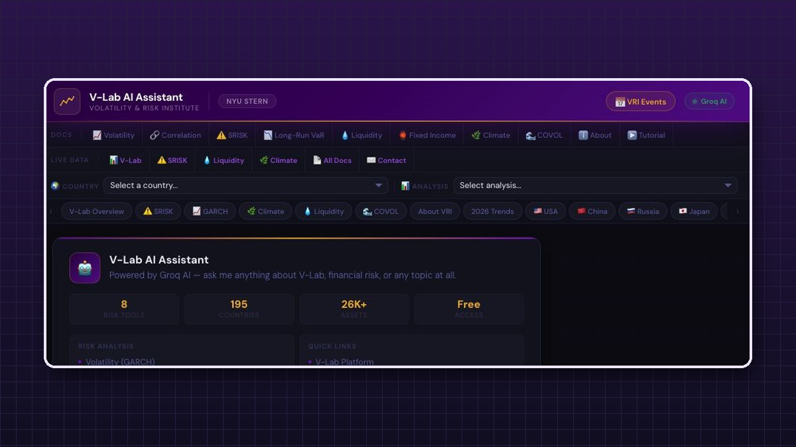
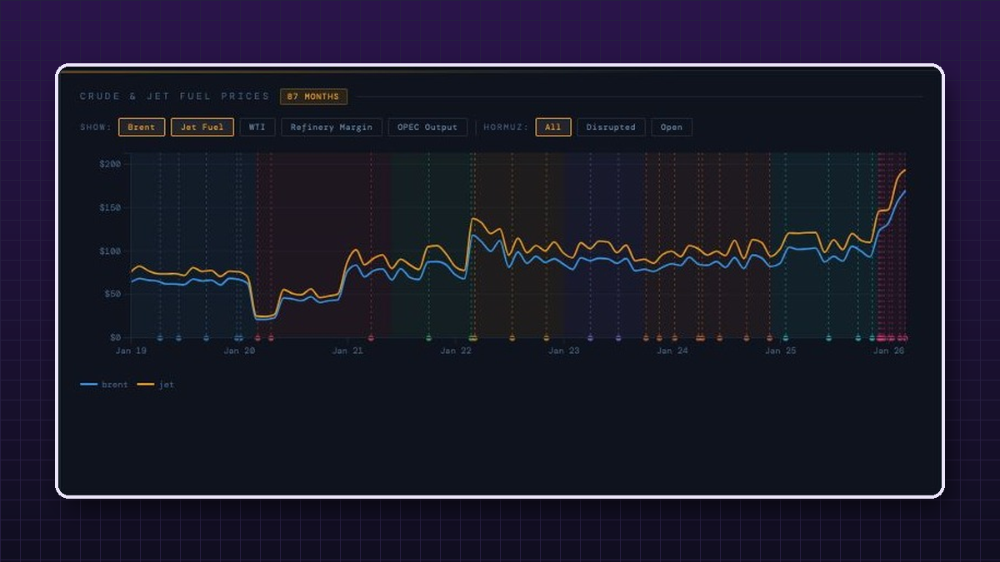
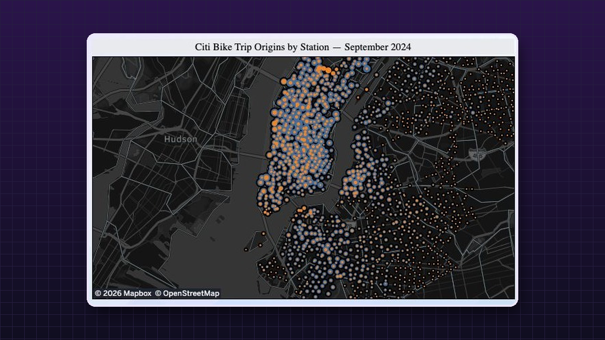
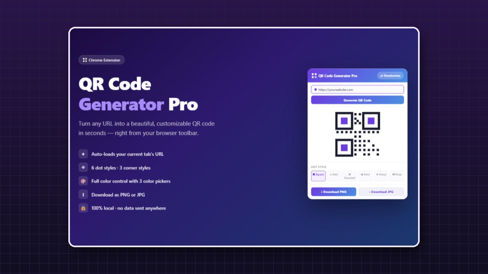
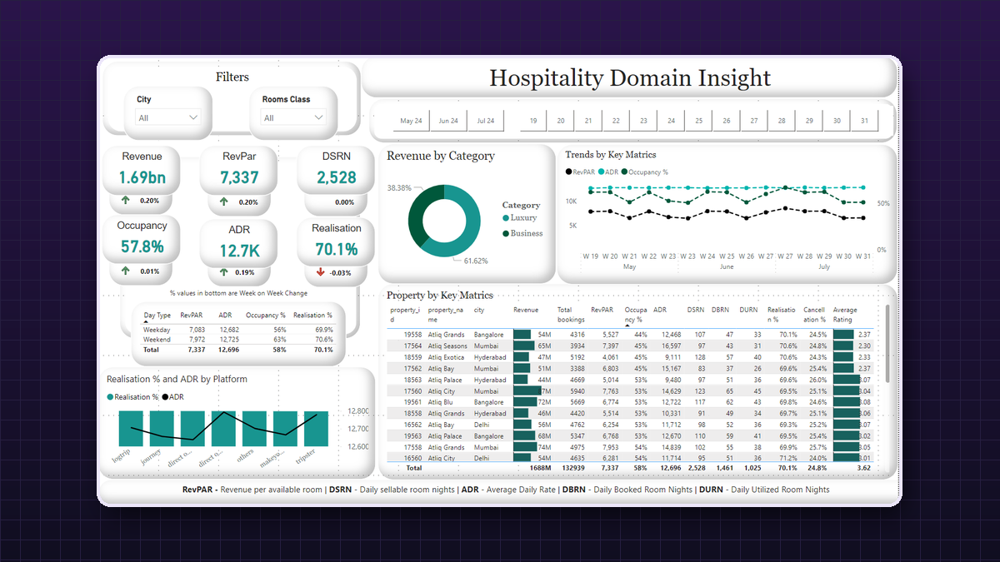
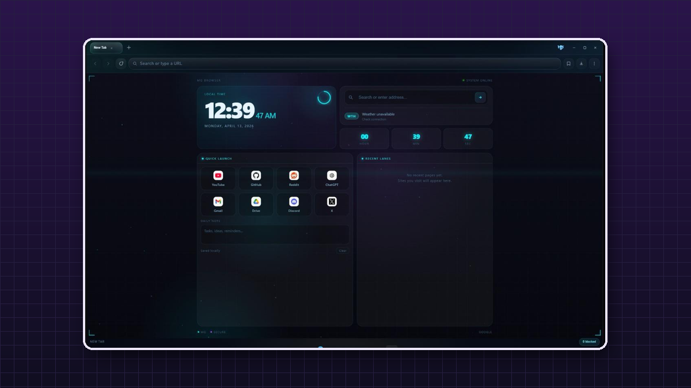

  

  
  
  
  

> [!TIP]
> **Open to full-time roles in AI Product · AI Engineering · Analytics** from **January 2027**.
> Brooklyn, NY · open to relocation · F-1 OPT, STEM eligible · [one-page portfolio →](https://mgupta646.github.io/#quick)

## About

I came to AI products from **aerospace engineering**, where a wrong input assumption doesn't produce a slightly wrong answer. It produces a part that fails. I still work that way. Most of my work is less about the model than the layer beneath it: whether an **evaluation measures what it claims to**, whether a **data source means what its name implies**, and what users **actually did**, not just what they said.

| Now | |
|---|---|
| **AI Product Graduate Fellow** · NYU Stern Center for Sustainable Business | Data pipelines, multi-agent LLM workflows and the requirements behind the ROSI platform |
| **Graduate Teaching Fellow** · NYU Stern, Futures & Options | Office hours, problem sets and grading for a graduate cohort |
| **MS, Management of Technology** · NYU Tandon | Graduating December 2026 · full scholarship, Government of India |
| *Previously* · **Graduate Assistant**, NYU Stern Volatility & Risk Institute | Built the V-Lab AI research assistant end to end |

## Selected work

<table>
  <tr>
    <td width="50%" valign="top">
      
      <h3>V-Lab Research Assistant</h3>
      
Multi-agent assistant for NYU Stern's public risk platform. I benchmarked <b>6 LLM providers</b> on a <b>40-point rubric</b>, caught that it rewarded fluency over correctness, rebuilt it, and shipped after <b>3 architectures</b>. After launch, I used usage logs to rank coverage gaps.

      

        
        
        
      

      <a href="https://vlabcb.vercel.app"><b>Live demo</b></a> · <a href="https://github.com/mgupta646/vlabcb">Code</a>
    </td>
    <td width="50%" valign="top">
      
      <h3>Aviation Crisis Intelligence</h3>
      
Linked dashboard on how conflicts and oil shocks hit <b>25 airlines</b> across <b>8 geopolitical phases</b> in <b>9 chart views</b>. A natural-language assistant returns structured filter intent through a server-side API proxy.

      

        
        
        
      

      <a href="https://aviation-chat.vercel.app/"><b>Live demo</b></a> · <a href="https://github.com/mgupta646/Aviation-Crisis-Intelligence">Code</a>
    </td>
  </tr>
  <tr>
    <td width="50%" valign="top">
      
      <h3>Citi Bike Analytics</h3>
      
<b>2M+ trip records</b> cleaned and analyzed in Python and SQL, then published as a Tableau dashboard with a conversational interface for station demand and rider behavior.

      

        
        
        
      

      <a href="https://public.tableau.com/app/profile/mehul.gupta7649/viz/Citibike1_17764341788430/DASHBOARD"><b>Dashboard</b></a> · <a href="https://mgupta646.github.io/CITIDASH/">Analytics site</a>
    </td>
    <td width="50%" valign="top">
      
      <h3>QR Code Generator Pro</h3>
      
Published on the <b>Chrome Web Store</b>. A toolbar extension that turns the current tab into a styled QR code: 6 dot styles, full color control, PNG/JPG export and <b>100% local processing</b>.

      

        
        
      

      <a href="https://chromewebstore.google.com/detail/qr-code-generator-pro/pfhgpgpkbknddkofmgknfeoaglljgbfb"><b>Chrome Web Store</b></a>
    </td>
  </tr>
  <tr>
    <td width="50%" valign="top">
      
      <h3>BI Dashboard Gallery</h3>
      
Tableau and Power BI work across HR attrition, hotel revenue (ADR, RevPAR, occupancy) and e-commerce performance, each built to move from a headline metric to the questions behind it.

      

        
        
        
      

      <a href="https://github.com/mgupta646/power-Bi-dashboards"><b>Power BI</b></a> · <a href="https://public.tableau.com/app/profile/mehul.gupta7649/vizzes">Tableau Public</a>
    </td>
    <td width="50%" valign="top">
      
      <h3>M Browser</h3>
      
A desktop browser for <b>Windows and Mac</b> that grew from a PyQt prototype into privacy controls, ad blocking and packaging. Each platform gets its own UI instead of one compromise interface.

      

        
        
      

      <a href="https://www.linkedin.com/feed/update/urn:li:activity:7449319946746122240/"><b>Project post</b></a>
    </td>
  </tr>
</table>

<a href="https://mgupta646.github.io/#quick"><b>See every case study, including ROSI, MaGic Filter, FlowMind AI and more →</b></a>

## Toolkit

**AI & product** &nbsp;

**Engineering** &nbsp;

**Data & BI** &nbsp;

**Engineering roots** &nbsp;

## Recognition

- **NASA Space Apps Challenge**: Regional Gold, 2023
- **Guinness World Record**: hydro-rocketry, fabrication lead, 2023
- **Top 30 globally, Ferrocampus 2025**: FlowMind AI, featured by NYU Tandon
- **Published**: *Design Analysis of a Low-Cost Subsonic Open-Section Wind Tunnel*, IJERT 2024
- **Full scholarship**, Government of India · **NYU Data Science Bootcamp** · **Google** AI Essentials & Data Science foundations

## My portfolio is a game

**[Mehul Town](https://mgupta646.github.io/)** is a GBA-style pixel town where every building is a case study. Walk up to a landmark to open its story, take the **guided tour**, or read everything at once in **[Quick View](https://mgupta646.github.io/#quick)**. Every sprite is drawn in code, with no frameworks and no build step ([source](https://github.com/mgupta646/mgupta646.github.io)).

---

  <a href="mailto:mg8671@nyu.edu"><b>mg8671@nyu.edu</b></a> · <a href="https://www.linkedin.com/in/mehulmg/">LinkedIn</a> · <a href="https://mgupta646.github.io/">Portfolio</a>
   Psst… try ↑ ↑ ↓ ↓ ← → ← → B A in the game.

