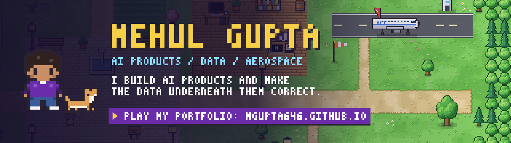

  

  
  
  
  
  

---

### 👋 Hi, I'm Mehul

I came to AI products from **aerospace engineering**, where a wrong input assumption doesn't produce a slightly wrong answer. It produces a part that fails. I still work that way: most of what I build is less about the model than the layer beneath it. Does the evaluation measure what it claims to? Does the data source mean what its name implies?

- 🧠 **AI Product Graduate Fellow**, NYU Stern Center for Sustainable Business: data pipelines and multi-agent LLM workflows for the ROSI platform
- 📈 **Graduate Teaching Fellow**, Futures & Options (FINC-GB 6043), NYU Stern
- 🤖 Previously built the **V-Lab AI research assistant** end to end for the NYU Stern Volatility & Risk Institute
- 🎓 **MS, Management of Technology**, NYU Tandon (Dec 2026) · **BE, Aerospace Engineering**, Chandigarh University (2024)
- 📍 Brooklyn, NY · **available January 2027** · open to relocation

---

### 🎮 My portfolio is a game

**[Mehul Town](https://mgupta646.github.io/)** is a GBA-style pixel town where every building is a piece of my work. Walk up to a landmark and its case study opens. Take the **guided tour** or read everything in **[Quick View](https://mgupta646.github.io/#quick)**. Every sprite is drawn in code, with no frameworks and no build step. ([source](https://github.com/mgupta646/mgupta646.github.io))

---

### ⭐ Featured work

<table>
  <tr>
    <td width="50%" valign="top">
      
      <h4>🤖 V-Lab Research Assistant</h4>
      Multi-agent AI assistant for NYU Stern's public risk platform. I benchmarked <b>6 LLM providers</b> on a <b>40-point rubric</b>, caught that it rewarded fluency over correctness, rebuilt it, and shipped after 3 architectures.  
      <a href="https://vlabcb.vercel.app">Live demo</a> · <a href="https://github.com/mgupta646/vlabcb">Code</a>
    </td>
    <td width="50%" valign="top">
      
      <h4>✈️ Aviation Crisis Intelligence</h4>
      Linked D3.js dashboard on how conflicts and oil shocks hit <b>25 airlines</b> across <b>8 phases</b>. A natural-language assistant (Groq, behind a server-side proxy) turns questions into chart filters.  
      <a href="https://aviation-chat.vercel.app/">Live demo</a> · <a href="https://github.com/mgupta646/Aviation-Crisis-Intelligence">Code</a>
    </td>
  </tr>
  <tr>
    <td width="50%" valign="top">
      
      <h4>🚲 Citi Bike Analytics</h4>
      <b>2M+ trips</b> cleaned and analyzed in Python and SQL, published as a Tableau dashboard with a conversational interface for station demand and rider behavior.  
      <a href="https://public.tableau.com/app/profile/mehul.gupta7649/viz/Citibike1_17764341788430/DASHBOARD">Dashboard</a> · <a href="https://mgupta646.github.io/CITIDASH/">Analytics site</a>
    </td>
    <td width="50%" valign="top">
      
      <h4>🔳 QR Code Generator Pro</h4>
      Published on the <b>Chrome Web Store</b>. A toolbar extension that turns the current tab into a styled QR code: 6 dot styles, full color control, PNG/JPG export, and 100% local processing.  
      <a href="https://chromewebstore.google.com/detail/qr-code-generator-pro/pfhgpgpkbknddkofmgknfeoaglljgbfb">Chrome Web Store</a>
    </td>
  </tr>
  <tr>
    <td width="50%" valign="top">
      
      <h4>📊 BI Dashboard Gallery</h4>
      Tableau and Power BI work across HR attrition, hotel revenue (ADR, RevPAR, occupancy) and e-commerce performance.  
      <a href="https://github.com/mgupta646/power-Bi-dashboards">Power BI</a> · <a href="https://public.tableau.com/app/profile/mehul.gupta7649/vizzes">Tableau Public</a>
    </td>
    <td width="50%" valign="top">
      
      <h4>🧭 M Browser · AdventureWorks Assistant</h4>
      A PyQt desktop browser for Windows and Mac with privacy controls and ad blocking, plus a chat assistant that answers questions over AdventureWorks sales data.  
      <a href="https://awwchat.vercel.app">Assistant demo</a> · <a href="https://github.com/mgupta646/awwchat">Code</a>
    </td>
  </tr>
</table>

---

### 🧰 Toolkit

  
  
  
  
  
  
  
  
  
  
  
  
  

  
  
  
  
  
  

---

### 🏆 Highlights

| | |
|---|---|
| 🥇 **NASA Space Apps Challenge**: Regional Gold (2023) | 🚀 **Guinness World Record**: hydro-rocketry, fabrication lead (2023) |
| 🚆 **Top 30 globally, Ferrocampus 2025**: FlowMind AI, featured by NYU Tandon | 📄 **Published**: wind-tunnel design paper, IJERT (2024) |
| 🎓 **Full scholarship**, Government of India | 🧩 **Chrome Web Store developer** · Google DevFest / GDG |

---

  <a href="https://mgupta646.github.io/"><b>▶ Walk around Mehul Town</b></a> · <a href="mailto:mg8671@nyu.edu">mg8671@nyu.edu</a> · <a href="https://www.linkedin.com/in/mehulmg/">LinkedIn</a>
   Psst… try ↑ ↑ ↓ ↓ ← → ← → B A in the game.

